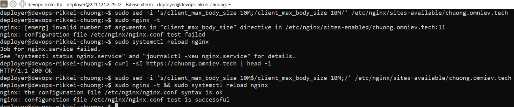

# Bài 4 — Tối ưu hoá và Reload cấu hình không gián đoạn

**Tình huống:**
1. Upload avatar 3MB bị lỗi `413 Request Entity Too Large`.
2. Trang tải chậm vì file JS/CSS quá lớn.

File cấu hình đầy đủ (tiếp nối bài 2): [`default`](default)

---

## 1. Cho phép upload tới 10MB: `client_max_body_size`

```nginx
server {
    ...
    client_max_body_size 10M;
    ...
}
```

**Vì sao bị 413?** Mặc định `client_max_body_size` là **`1m`**. Khi thấy `Content-Length` vượt giới hạn, Nginx trả `413` **ngay lập tức**, request không bao giờ tới được backend. Vì vậy log của backend không có dấu vết gì, rất dễ đổ nhầm lỗi cho code.

| Đặt ở | Phạm vi |
|---|---|
| `http { }` (nginx.conf) | Mọi site trên server |
| `server { }` | Mọi đường dẫn của site này (cách dùng trong bài) |
| `location { }` | Chỉ một endpoint. **Chặt chẽ nhất**, chỉ nới cho đúng API upload |

```nginx
# Cách chặt hơn: site giữ mặc định 1m, chỉ endpoint upload được 10MB
location = /api/users/avatar {
    client_max_body_size 10M;
    proxy_pass http://127.0.0.1:8080;
}
```

> ⚠️ **Bẫy thứ hai ở backend:** Spring Boot cũng giới hạn file upload mặc định **1MB** (`max-file-size`). Sửa Nginx xong, ảnh 3MB sẽ qua được Nginx nhưng lại bị Spring chặn (`MaxUploadSizeExceededException`). Phải nới cả hai tầng:
> ```yaml
> spring:
>   servlet:
>     multipart:
>       max-file-size: 10MB
>       max-request-size: 10MB
> ```

## 2. Bật nén Gzip

```nginx
gzip on;
gzip_vary on;
gzip_proxied any;
gzip_comp_level 5;
gzip_min_length 256;
gzip_types
    text/plain
    text/css
    text/xml
    text/javascript
    application/javascript
    application/x-javascript
    application/json
    application/xml
    application/rss+xml
    application/manifest+json
    image/svg+xml
    font/ttf
    font/otf;
```

| Chỉ thị | Ý nghĩa |
|---|---|
| `gzip on` | Bật nén. Chỉ nén khi trình duyệt gửi `Accept-Encoding: gzip` (mọi trình duyệt đều gửi) |
| `gzip_types` | Loại nội dung được nén. **Mặc định chỉ có `text/html`**, nên nếu chỉ bật `gzip on` thì JS/CSS/JSON **không được nén**. `text/html` luôn được nén, không cần liệt kê |
| `gzip_comp_level 5` | Mức nén từ 1 đến 9. Mức 5 cho kích thước gần bằng mức 9 nhưng tốn ít CPU hơn nhiều |
| `gzip_min_length 256` | File dưới 256 byte không nén, vì header gzip làm file nhỏ còn to hơn |
| `gzip_proxied any` | Vẫn nén khi request đi qua proxy hoặc CDN (có header `Via`). Mặc định `off` |
| `gzip_vary on` | Thêm `Vary: Accept-Encoding` để CDN cache riêng bản nén và bản không nén |

**Không nén** ảnh `jpg/png/webp`, video, `zip`, `woff2`: các định dạng này đã được nén sẵn, nén lại chỉ tốn CPU mà không nhỏ đi.

> **Lưu ý trên Ubuntu:** `/etc/nginx/nginx.conf` đã có sẵn dòng `gzip on;` trong khối `http`, kèm các dòng `gzip_*` bị comment.
> - Hoặc **bỏ comment** các dòng `gzip_*` ngay trong nginx.conf.
> - Hoặc đặt ở khối `server` như bài này.
>
> Nếu tạo file `conf.d/gzip.conf` chứa thêm `gzip on;`, Nginx sẽ báo lỗi `"gzip" directive is duplicate`, vì `conf.d/` được include vào chính khối `http` đó.

## 3. Kết quả chạy thử (Nginx 1.18.0, Docker)

So sánh **trước** (cấu hình bài 2, mặc định) và **sau** (thêm 2 phần trên). Dùng file thật: `react-dom.production.min.js`, `bootstrap.min.css`, và JSON 500 sản phẩm.

```text
===== TRƯỚC
upload avatar-3mb  -> 413 Request Entity Too Large
upload big-11mb    -> 413 Request Entity Too Large
/static/app.js       131835 B ->   131835 B  (không nén)
/static/style.css    232803 B ->   232803 B  (không nén)
/api/products         59282 B ->    59282 B  (không nén)

===== SAU
upload avatar-3mb  -> 200 BACKEND nhan upload: Content-Length=3145932 bytes
upload big-11mb    -> 413 Request Entity Too Large      ← vẫn chặn file > 10MB (đúng)
/static/app.js       131835 B ->    43387 B  gzip   (-67%)
/static/style.css    232803 B ->    31840 B  gzip   (-86%)
/api/products         59282 B ->     4215 B  gzip   (-93%)
/  (index.html)         209 B ->      209 B  (< 256 B, không nén - đúng)

Content-Type: application/javascript
Vary: Accept-Encoding
Content-Encoding: gzip
```

Lượng dữ liệu tải về giảm từ **424 KB xuống 79 KB (−81%)**. Trên mạng 4G yếu, chênh lệch này là vài giây tải trang.

## 4. Bẫy cực kỳ nguy hiểm: `restart` hay `reload`?

### Trả lời ngắn

```bash
sudo nginx -t                    # 1. LUÔN kiểm tra cú pháp TRƯỚC
sudo systemctl reload nginx      # 2. reload, KHÔNG restart

# viết gọn: chỉ reload khi test thành công
sudo nginx -t && sudo systemctl reload nginx
```

### Khác biệt chí mạng

Nginx gồm **1 master process** (đọc config, giữ các socket port 80/443) và **nhiều worker process** (xử lý request).

| | `systemctl restart nginx` | `systemctl reload nginx` |
|---|---|---|
| Cơ chế | **Dừng hẳn** cả master và worker, rồi khởi động lại từ đầu | Gửi tín hiệu `HUP` cho master. Master **giữ nguyên socket**, đọc config mới, tạo worker mới; worker cũ **làm nốt** request đang dở rồi mới thoát |
| Port 80/443 | **Bị đóng** trong lúc khởi động lại, khách mới bị `Connection refused` | **Không bao giờ đóng** |
| Khách đang tải trang, upload, thanh toán | **Bị cắt ngang** | Được phục vụ tới khi xong |
| Config **sai cú pháp** | Nginx đã dừng nhưng **không khởi động lại được**, nên **toàn bộ site sập** cho tới khi có người sửa | Master kiểm tra config mới **trước**. Nếu sai thì báo lỗi và **tiếp tục chạy bằng config cũ**. Site không bị ảnh hưởng |

```
reload:  master(giữ :80/:443) ──┬── worker cũ  ──(xong request đang dở)──▶ thoát
                                └── worker mới ──(nhận mọi request mới)──────────▶
restart: master ──✖ dừng──▶ [ port đóng: khách bị từ chối ] ──▶ master mới ──▶
```

### Đo thực tế: tải liên tục + 1 khách đang tải file 2MB

Mô phỏng đúng cách `systemctl` trên Ubuntu chạy hai lệnh: restart gửi `QUIT`, chờ 5 giây rồi `KILL`, chạy `nginx -t`, sau đó start; reload chạy `nginx -s reload`. Trong 9 giây có request mới liên tục (khoảng 35 request/giây) và một khách đang tải file 2MB với tốc độ chậm. Lệnh được gõ ở giây thứ 2.

| Kịch bản | Request mới thất bại | Khách đang tải 2MB | Site sau đó |
|---|---|---|---|
| **1. `reload`, config đúng** | **0 / 312** ✅ | Tải xong ✅ | Chạy config mới |
| **2. `restart`, config đúng** | **207 / 333** ❌ (~5,5 giây mất kết nối) | **Bị cắt ngang** ở 2.047.745/2.097.152 B ❌ | Chạy lại |
| **3. `reload`, config SAI** | **0 / 288** ✅ | Tải xong ✅ | **Vẫn chạy config cũ**, chỉ báo lỗi `[emerg]` |
| **4. `restart`, config SAI** | **255 / 327** ❌ và còn tiếp | **Bị cắt ngang** ❌ | **SẬP HOÀN TOÀN** 💀 |

Log thực tế của kịch bản 4:

```text
[restart] sau 5s van con request -> KILL
nginx: [emerg] invalid number of arguments in "client_max_body_size" directive in /etc/nginx/conf.d/default.conf:26
nginx: configuration file /etc/nginx/nginx.conf test failed
[restart] nginx -t LOI -> KHONG KHOI DONG DUOC
```

Chỉ vì thiếu **một dấu `;`**: với `reload`, khách hàng không hề biết có lỗi; với `restart`, cả website E-commerce ngừng bán hàng.

### Quy trình chuẩn trên production

```bash
# 0. Sao lưu trước khi sửa
sudo cp /etc/nginx/sites-available/default /etc/nginx/sites-available/default.bak.$(date +%F-%H%M)

# 1. Sửa config
sudo nano /etc/nginx/sites-available/default

# 2. Kiểm tra cú pháp - LỆNH GÕ ĐẦU TIÊN
sudo nginx -t
#   nginx: the configuration file /etc/nginx/nginx.conf syntax is ok
#   nginx: configuration file /etc/nginx/nginx.conf test is successful

# 3. Áp dụng không gián đoạn
sudo systemctl reload nginx

# 4. Xác nhận
systemctl status nginx --no-pager
sudo tail -n 20 /var/log/nginx/error.log
curl -sI -H "Accept-Encoding: gzip" https://domain.com/static/js/main.js | grep -i content-encoding
```

| Lệnh | Dùng khi |
|---|---|
| `nginx -t` | Kiểm tra cú pháp **và** kiểm tra file tham chiếu có tồn tại không (cert, include...) |
| `nginx -T` | Như `-t`, nhưng **in ra toàn bộ config** sau khi gộp mọi file include. Dùng để tìm chỉ thị bị trùng hay bị ghi đè |
| `systemctl reload nginx` | **Mọi thay đổi config** (kể cả thêm site, đổi port, thay chứng chỉ SSL) |
| `systemctl restart nginx` | Hiếm khi cần: Nginx bị treo hoặc không phản hồi tín hiệu. Chỉ làm **ngoài giờ cao điểm** và sau khi đã `nginx -t` |

> `nginx -t` chỉ kiểm tra **cú pháp**, không kiểm tra **logic**: trỏ nhầm port hay sai `server_name` thì vẫn báo "successful". Vì vậy luôn kiểm tra lại bằng `curl` sau khi reload.

## 5. Áp dụng thật trên production: `chuong.omniev.tech`

VPS chạy Ubuntu 22.04 và Nginx 1.18, có HTTPS từ bài 3. File cấu hình đã áp dụng: [`chuong.omniev.tech`](chuong.omniev.tech). Đây là file do certbot sinh ra ở bài 3, thêm `client_max_body_size` và `gzip_*` vào block 443, cùng một endpoint `/api/upload` để thử upload.

`nginx.conf` trên VPS xác nhận đúng điều đã nói ở mục 2: có sẵn `gzip on;` nhưng `gzip_types` bị comment, nên **chỉ HTML được nén**:

```text
$ grep -n gzip /etc/nginx/nginx.conf
46:     gzip on;
48:     # gzip_vary on;
...
53:     # gzip_types text/plain text/css application/json application/javascript ...
```

### Kết quả đo từ bên ngoài (Internet → `https://chuong.omniev.tech`)

| Request | Trước | Sau |
|---|---|---|
| `GET /static/app.js` | 131.835 B, không nén | **43.387 B**, `gzip` (−67%) |
| `GET /static/style.css` | 232.803 B, không nén | **31.840 B**, `gzip` (−86%) |
| `GET /api/products.json` | 59.281 B, không nén | **4.212 B**, `gzip` (−93%) |
| `GET /` (79 B) | `gzip` (mặc định của Ubuntu) | Không nén, vì < `gzip_min_length 256` |
| `POST /api/upload` 3MB | **`413`** | **`200`** `Upload OK: Nginx da nhan 3145728 bytes` |
| `POST /api/upload` 11MB | `413` | `413` (vẫn chặn file > 10MB) |
| `http://` → `https://` (bài 3) | `301` | `301`, không bị ảnh hưởng |

Mọi phản hồi được nén đều kèm `Vary: Accept-Encoding`.

### Thử bẫy trên production: `reload` với config sai

Cố tình xoá dấu `;`, rồi chạy `nginx -t` và `reload`:



1. `nginx -t` **bắt được lỗi** trước khi áp dụng: `[emerg] invalid number of arguments in "client_max_body_size"`.
2. `systemctl reload nginx` → `Job for nginx.service failed`: Nginx **từ chối** nạp config sai.
3. Ngay sau đó `curl` vẫn nhận **`HTTP/1.1 200 OK`**: site **không sập**, vẫn phục vụ bằng config cũ.
4. Sửa lại dấu `;`, rồi `nginx -t && systemctl reload nginx` → áp dụng thành công.

Nếu ở bước 2 gõ `systemctl restart nginx`, Nginx sẽ dừng hẳn mà không khởi động lại được, tức là kịch bản 4 ở mục 4: **website sập hoàn toàn**.
