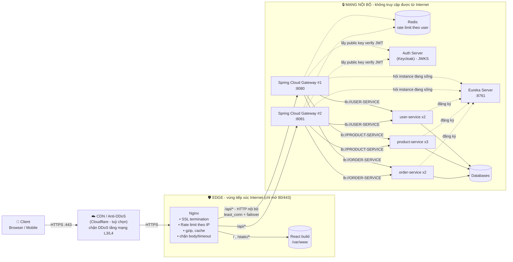
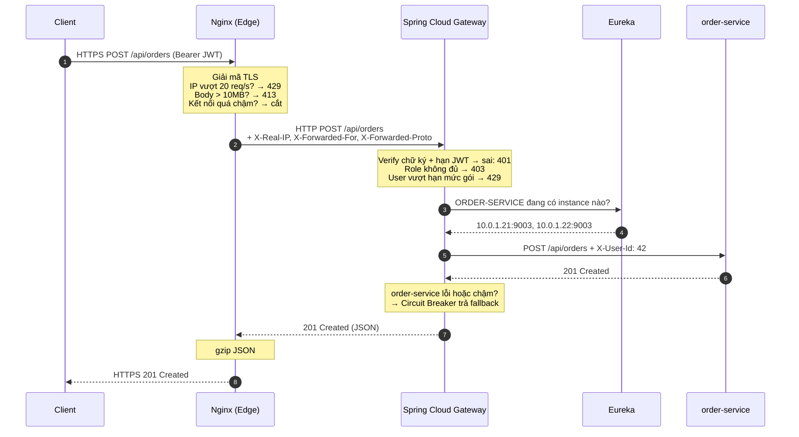

# Bài 5 — API Gateway (Spring Cloud) vs Reverse Proxy (Nginx)

> **Ý kiến cần phản biện:** *"Chúng ta đã có Spring Cloud Gateway đảm nhiệm việc gom API rồi, tại sao vẫn phải tốn tài nguyên chạy thêm Nginx ở phía trước nó nữa? Bỏ Nginx đi, mở cổng 80 cho Spring Gateway luôn!"*

**Kết luận của Architect:** **Không bỏ Nginx.** Hai thành phần trông giống nhau vì cùng "nhận request rồi chuyển tiếp", nhưng chúng đứng ở **hai tầng khác nhau** và giải quyết **hai loại bài toán khác nhau**:

| | Nginx | Spring Cloud Gateway |
|---|---|---|
| Vị trí | **Rìa mạng (Edge)**, cửa ngõ duy nhất từ Internet | **Bên trong**, cửa ngõ vào cụm microservices |
| Câu hỏi nó trả lời | "Request này có **đáng được vào** hệ thống không?" | "Request này là của **ai**, được làm **gì**, đi tới **service nào**?" |
| Hiểu ở mức | Kết nối, IP, byte, URL, TLS | User, JWT, role, service, nghiệp vụ |
| Ví von | **Bảo vệ toà nhà**: soát cổng, chặn kẻ gây rối, chỉ đường lên sảnh | **Lễ tân**: kiểm tra thẻ nhân viên, biết phòng ban nào ở tầng mấy, chuyển đúng người |

Bỏ Nginx không làm hệ thống gọn hơn. Nó chỉ dồn **việc của bảo vệ** sang cho **lễ tân**, người đắt hơn, chậm hơn ở việc đó, và là người không được phép ngã.

File cấu hình edge đầy đủ: [`edge.conf`](edge.conf), đã chạy thử, kết quả ở [mục 7](#7-chứng-minh-bằng-thực-nghiệm).

---

## 1. Phân tích lập luận "tốn tài nguyên"

Lập luận này **đúng một nửa**: Nginx đúng là một tiến trình nữa phải chạy. Nhưng nó sai ở chỗ coi Nginx là chi phí cộng thêm, trong khi thực tế Nginx **gánh bớt tải** cho Gateway:

- **Nginx rất rẻ.** Viết bằng C, kiến trúc event-driven: mỗi worker xử lý hàng nghìn kết nối bằng vài MB RAM. Một Spring Cloud Gateway (JVM) thường cần **hàng trăm MB heap**, cộng thêm thời gian khởi động và GC.
- **Mọi việc Nginx làm, nếu bỏ Nginx thì JVM phải làm**, bằng tài nguyên đắt hơn: giải mã TLS, nén gzip, trả file JS/CSS, và tệ nhất là **tiếp đón cả request rác**.
- Trong thử nghiệm ở mục 7, một IP bắn 200 request vào `/api/`: **150 request bị Nginx chặn** ngay ở tầng biên, Gateway không tốn một chu kỳ CPU nào cho chúng.

Câu hỏi đúng không phải là "có tốn thêm một tiến trình không", mà là **"tầng nào nên chịu đòn?"**. Câu trả lời: tầng rẻ nhất, ổn định nhất, và **không chứa logic nghiệp vụ**.

## 2. Thế mạnh của Nginx: chiến binh ở rìa mạng

| Năng lực | Nginx làm thế nào | Đã chứng minh ở |
|---|---|---|
| **SSL termination** | Giải mã TLS một lần ở biên, phía sau dùng HTTP nội bộ. Có session cache, HTTP/2. **Certbot tự cấu hình và tự gia hạn** | Bài 3 (`chuong.omniev.tech`, Let's Encrypt, timer renew) |
| **Phục vụ file tĩnh** | Dùng `sendfile` từ kernel, không đi qua JVM. Đặt `Cache-Control: immutable` cho file có hash trong tên | Bài 5, mục 7A |
| **Nén gzip** | JS −67%, CSS −86%, JSON −93% | Bài 4 (đo trên production) |
| **Rate limit theo IP** | `limit_req`, `limit_conn`: chặn flood, brute-force, crawler bằng **429** trước khi vào hệ thống | Bài 5, mục 7B, 6C |
| **Chống Slowloris và request quá khổ** | `client_header_timeout`, `client_body_timeout`, `client_max_body_size`: cắt kết nối "rỉ rả" và body khổng lồ | Bài 4 (413) |
| **Load balancing và failover** | `upstream` gồm nhiều Gateway, `proxy_next_upstream`: một Gateway chết hoặc đang deploy thì chuyển sang Gateway còn lại | Bài 5, mục 7D |
| **Trang bảo trì** | `error_page 502 503 504`: Gateway sập thì vẫn trả JSON hoặc trang thân thiện, **frontend vẫn sống** | Bài 1 (502), bài 5 mục 7E |
| **Thu hẹp bề mặt tấn công** | Chỉ mở `/api/` vào trong. `/actuator`, `/eureka`, port 8080/8761... **không có đường nào** từ Internet đi tới | Bài 2 (đóng port 8080), bài 5 mục 7A |
| **Reload không gián đoạn** | `nginx -t && reload`: config sai thì không áp dụng, site vẫn sống | Bài 4 (thử trên production) |
| **Giữ IP thật của client** | `X-Real-IP`, `X-Forwarded-For`, `X-Forwarded-Proto` | Bài 2 |

**Nginx không làm được, hoặc làm rất vất vả:**
- Không hiểu JWT. Bản miễn phí không validate được token; phải dùng Nginx Plus hoặc viết Lua (OpenResty).
- Không tích hợp Eureka. `upstream` là danh sách IP tĩnh, service scale lên hay xuống thì phải sửa file và reload.
- Không có logic nghiệp vụ: không biết user nào là VIP, đơn hàng nào cần chuyển sang service nào.

## 3. Thế mạnh của Spring Cloud Gateway: bộ não định tuyến nội bộ

| Năng lực | Spring Cloud Gateway làm thế nào |
|---|---|
| **Bảo mật tầng ứng dụng (JWT/OAuth2)** | Spring Security Resource Server validate chữ ký JWT, hạn dùng, `issuer`, `scope` và role **tại một điểm duy nhất**. Các service phía sau không phải tự làm lại |
| **Service Discovery (Eureka)** | `uri: lb://PRODUCT-SERVICE`: Gateway hỏi Eureka danh sách instance **đang sống** và tự cân bằng tải. Service scale từ 2 lên 10 instance mà không phải sửa cấu hình |
| **Filter nghiệp vụ** | Đọc `userId` từ JWT rồi gắn header `X-User-Id` cho service, đổi đường dẫn (`RewritePath`), gom nhiều API thành một (BFF), ghi log audit theo user |
| **Rate limit theo user hoặc gói cước** | `RequestRateLimiter` dùng Redis, đếm theo **userId/API key** (ví dụ gói Free 10 req/s, gói Pro 100 req/s). Đây là chỗ Nginx (chỉ biết IP) không làm được |
| **Chịu lỗi** | `CircuitBreaker` (Resilience4j), `Retry`, `fallbackUri`: order-service chậm thì ngắt mạch, trả fallback, không kéo sập cả hệ thống |
| **Triển khai an toàn** | Predicate `Weight`, `Header`: canary 5% traffic sang version mới, A/B testing |
| **Viết bằng Java/Spring** | Cùng ngôn ngữ, cùng bộ công cụ với đội dev: test, debug, CI/CD như mọi service khác |

Ví dụ cấu hình:

```yaml
# application.yml - api-gateway
# (Spring Cloud 2025.0+: tiền tố spring.cloud.gateway.server.webflux; bản cũ hơn: spring.cloud.gateway)
spring:
  application:
    name: api-gateway
  security:
    oauth2:
      resourceserver:
        jwt:
          issuer-uri: https://auth.my-ecommerce.com/realms/shop    # validate JWT
  cloud:
    gateway:
      server:
        webflux:
          routes:
            - id: product-service
              uri: lb://PRODUCT-SERVICE            # lấy địa chỉ từ Eureka
              predicates:
                - Path=/api/products/**
              filters:
                - name: CircuitBreaker
                  args:
                    name: productCB
                    fallbackUri: forward:/fallback/products
            - id: order-service
              uri: lb://ORDER-SERVICE
              predicates:
                - Path=/api/orders/**
              filters:
                - name: RequestRateLimiter         # giới hạn theo USER, không phải IP
                  args:
                    redis-rate-limiter.replenishRate: 10
                    redis-rate-limiter.burstCapacity: 20
                    key-resolver: "#{@userKeyResolver}"

eureka:
  client:
    service-url:
      defaultZone: http://eureka-server:8761/eureka/
```

**Spring Cloud Gateway không nên làm ở rìa mạng:**
- **Bind port 80/443:** port dưới 1024 cần quyền root (hoặc `CAP_NET_BIND_SERVICE`). Chạy JVM bằng root là rủi ro bảo mật.
- **Quản lý chứng chỉ TLS:** phải đổi sang keystore hoặc SSL bundle trong Spring, certbot **không tự cài** được như với Nginx.
- **Phục vụ file tĩnh của React:** dùng JVM để trả file JS/CSS là lãng phí. Hơn nữa, deploy frontend lại phải build và deploy cả Gateway.
- **Hứng request rác:** mọi kết nối flood hay quét lỗ hổng đều tiêu tốn CPU, heap và GC của tầng đang giữ logic xác thực quan trọng nhất.

## 4. Nếu bỏ Nginx: chuyện gì sẽ xảy ra?

| Tình huống | Có Nginx ở biên | Mở thẳng port 80/443 cho Spring Gateway |
|---|---|---|
| Deploy phiên bản Gateway mới | Nginx chuyển traffic sang instance còn lại: **0 request lỗi** (mục 7D) | Process giữ port phải dừng: **downtime mỗi lần deploy**. Muốn chạy 2 instance thì lại cần một load balancer phía trước, tức là quay lại cần Nginx |
| Gateway bị lỗi hoặc OOM | Frontend vẫn hiện, API trả JSON bảo trì `503` (mục 7E) | **Trắng trang**, trình duyệt báo "This site can't be reached" |
| Bot bắn 10.000 req/s vào `/api/auth/login` | `429` ngay ở biên, Gateway không biết gì (mục 7C) | JVM phải giải mã TLS, parse HTTP, chạy security filter chain cho **từng** request rác |
| Gia hạn SSL | Certbot tự động, `reload` không gián đoạn (bài 3) | Chuyển PEM sang keystore, cấu hình reload, dễ quên dẫn tới **hết hạn chứng chỉ** |
| Frontend React | Nginx trả từ đĩa, gzip, cache 1 năm | Đóng gói vào Gateway, hoặc cần thêm một server khác |
| `/actuator/env`, Eureka dashboard | Không có đường nào từ Internet tới | Chỉ cần cấu hình sai một dòng là **lộ biến môi trường và mật khẩu DB** ra Internet |

## 5. Phân chia trách nhiệm: không phải trùng lặp mà là phòng thủ nhiều lớp

Một số tính năng có ở **cả hai** nhưng ở **mức độ chi tiết khác nhau**. Đó là **Defense in Depth** (phòng thủ nhiều lớp), không phải lãng phí:

| Tính năng | Nginx (edge), thô và nhanh | Spring Cloud Gateway (app), tinh và hiểu nghiệp vụ |
|---|---|---|
| Rate limit | Theo **IP**: 20 req/s, login 5 lần/phút | Theo **user hoặc gói cước**: Free 10 req/s, Pro 100 req/s |
| Định tuyến | Theo **đường dẫn**: `/` sang file tĩnh, `/api/` sang Gateway | Theo **service**: `/api/orders/**` sang `lb://ORDER-SERVICE` |
| Load balancing | Giữa các **instance Gateway** (danh sách tĩnh) | Giữa các **instance service** (động, lấy từ Eureka) |
| Bảo mật | TLS, chặn IP, giới hạn kích thước, ẩn file | JWT, phân quyền theo role, CORS, audit |
| Xử lý lỗi | Gateway chết thì trả trang bảo trì | Service chết thì circuit breaker trả fallback |

## 6. Sơ đồ luồng dữ liệu (Data flow) chuẩn

### 6.1 Kiến trúc tổng thể



### 6.2 Hành trình của một request `POST /api/orders`



### 6.3 Bản rút gọn (ASCII)

```
Client ──HTTPS──▶ [CDN/Anti-DDoS] ──▶ NGINX (Edge, :443) ─────────────────────────────────────┐
                                        │ TLS · rate limit IP · gzip · static · timeout · 413   │
                                        ├── /, /static/*  ──▶ React build (đĩa)                 │
                                        └── /api/*  ──HTTP──▶ SPRING CLOUD GATEWAY (x2, nội bộ) │
                                                                │ JWT · rate limit user · CB   │
                                                                ├─▶ Eureka: lb://SERVICE        │
                                                                ├─▶ user-service    ──▶ DB      │
                                                                ├─▶ product-service ──▶ DB      │
                                                                └─▶ order-service   ──▶ DB      │
Internet chỉ thấy :80/:443 của Nginx ◀─────────────────────────────────────────────────────────┘
```

## 7. Chứng minh bằng thực nghiệm

[`edge.conf`](edge.conf) được chạy trên **Nginx 1.18.0** (cùng bản với VPS), đứng trước **2 instance Gateway giả lập** ở `127.0.0.1:8080` và `:8081`. Client gửi request từ một container khác.

### A) Định tuyến: frontend không chạm Gateway

```text
/                       -> 200  REACT index.html                 cache-control: no-cache
/products               -> 200  REACT index.html  (React Router, F5 không bị 404)
/static/main.3f9a2c.js  -> 200  [gzip 43387 B]                   cache-control: max-age=31536000 + cache-control: public, immutable
/api/products           -> 200  GATEWAY-1 uri=/api/products xff=172.23.0.3 proto=https
/api/products           -> 200  GATEWAY-2 uri=/api/products xff=172.23.0.3 proto=https   ← cân bằng tải
/api/orders/1           -> 200  GATEWAY-1 uri=/api/orders/1
/actuator/env           -> 200  REACT index.html   ← KHÔNG có đường tới /actuator của Gateway
/.env                   -> 404                     ← file ẩn bị chặn
http://.../api/products -> 301  https://my-ecommerce.com/api/products
```

### B) Flood: một IP bắn 200 request song song vào `/api/products`

```text
     50  200
    150  429 Too Many Requests     ← bị chặn ở biên
```

### C) Brute-force đăng nhập: 10 lần liên tiếp vào `/api/auth/login`

```text
200 200 200 200 429 429 429 429 429 429      ← 1 + burst 3, sau đó chặn
```

**Đếm từ log của Gateway:** sau A, B, C, client gửi tổng cộng **210 request** vào `/api/`, nhưng Gateway chỉ nhận **57** (GW1 = 28, GW2 = 29). Tức là **73% traffic bị Nginx lọc bỏ** trước khi tới JVM.

### D) Gateway #1 sập (đang deploy hoặc bị lỗi)

```text
GATEWAY-2 (200)  GATEWAY-2 (200)  GATEWAY-2 (200)  GATEWAY-2 (200)  ... (16/16 request thành công)
```

### E) Cả 2 Gateway sập

```text
/api/products          -> 503 {"status":503,"message":"He thong dang bao tri, vui long thu lai sau it phut"}
/                      -> 200 REACT index.html          ← website VẪN HIỆN
/products              -> 200 REACT index.html
/static/main.3f9a2c.js -> 200 (file JS)
```

Nếu bỏ Nginx, kịch bản D là **downtime** và kịch bản E là **trắng trang**.

## 8. Khi nào có thể "không cần Nginx"?

Một kiến trúc sư cần công bằng: có những hệ thống không chạy Nginx ở phía trước Gateway. Nhưng **vai trò edge không biến mất, chỉ là được thay bằng sản phẩm khác**:

| Môi trường | Thứ đảm nhận vai trò edge |
|---|---|
| AWS / GCP / Azure | Load Balancer (ALB) + CDN (CloudFront) + WAF |
| Kubernetes | Ingress Controller: phổ biến nhất chính là **ingress-nginx**, hoặc Envoy/Traefik |
| Cloudflare | Proxy (mây cam): TLS, chống DDoS, cache. Nhưng vẫn cần thứ gì đó phục vụ file tĩnh và cân bằng tải giữa các Gateway |

> **Nginx không thay thế được Gateway, Gateway cũng không thay thế được Nginx.** Có thể đổi **sản phẩm** đảm nhận tầng edge, nhưng **không thể bỏ tầng edge**. Với hệ thống tự vận hành trên VPS như hiện tại, Nginx là lựa chọn rẻ, nhẹ và đã được chứng minh qua bài 1–4.

**Lưu ý:** Nginx chặn tốt tấn công **tầng ứng dụng (L7)** như flood request, brute-force, slowloris. Còn **DDoS dung lượng lớn ở tầng mạng (L3/L4)**, ví dụ hàng chục Gbps, sẽ làm nghẽn đường truyền của VPS trước khi gói tin tới được Nginx. Loại này cần thêm CDN hoặc Anti-DDoS của nhà cung cấp (Cloudflare) đứng **trước** Nginx, như trong sơ đồ 6.1.

## 9. Kết luận

1. **Nginx ở rìa mạng để "chặn đạn":** SSL termination, rate limit theo IP, chống slowloris và request quá khổ, gzip, phục vụ file tĩnh, cân bằng tải và failover giữa các Gateway, trang bảo trì, che giấu hạ tầng nội bộ. Tất cả với chi phí vài MB RAM.
2. **Spring Cloud Gateway ở bên trong để "điều phối thông minh":** xác thực JWT, phân quyền, Service Discovery qua Eureka, rate limit theo user, circuit breaker, filter nghiệp vụ.
3. **Bỏ Nginx không tiết kiệm được gì.** Gateway phải gánh thêm việc của Nginx bằng tài nguyên đắt hơn, hệ thống mất khả năng deploy không downtime, và lộ trực tiếp tầng chứa logic quan trọng nhất ra Internet.

> **Đề xuất:** giữ nguyên kiến trúc **Client → (CDN) → Nginx → Spring Cloud Gateway → Microservices**, mỗi tầng làm đúng việc của mình. Chỉ mở port 80/443 của Nginx ra Internet, mọi port khác (8080, 8761, DB...) đều đóng.
